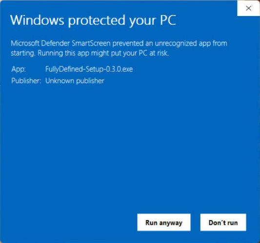

# FullyDefined – AI for SOLIDWORKS

**A SolidWorks MCP server** that lets Claude, Gemini/Antigravity and other AI apps build fully defined SOLIDWORKS
parts, assemblies and drawings.

**To install: download `FullyDefined-Setup-<version>.exe` from the [Releases page](https://github.com/adinomyerson/FullyDefined-AI-for-SOLIDWORKS/releases), double-click it, tick
your AI apps and click Install.**

Lets an AI assistant build and inspect SolidWorks models. You describe a part in plain language; the assistant uses
this server's tools to drive SolidWorks, and every result is checked by measuring the model. Works with AI apps
that run local [MCP](https://modelcontextprotocol.io/) servers.

**Tested with** Claude Desktop and Claude Code, using the Claude Opus and Claude Sonnet models; installed and used
on Antigravity. Other apps and models are your choice: they should work, but may work less well (please report).

## What it can do

- **Parts:** sketches fully defined from your own dimensions (lines, arcs, circles, rectangles, polygons, slots);
  extrude, cut, revolve, sweep, loft, fillet, chamfer, shell, mirror, linear and circular patterns, Hole Wizard
  holes, reference planes, surfaces, materials, colours and equations.
- **Sheet metal and weldments:** base, edge and miter flanges, tabs, hems, sketched bends, forming tools, flatten
  and a flat-pattern DXF; structural members and their cut list.
- **Assemblies:** add, move, fix, hide, replace and delete components; mates (add, edit, suppress, delete);
  interference checks; exploded views.
- **Drawings:** standard, section and detail views, dimensions, balloons, a bill of materials with your own
  columns (material, part number), centre marks and centrelines, dimension precision, title block and sheets.
- **Files:** STEP, STL and PDF export; custom properties (part number, description, linked mass or material).
- **Checked, not assumed:** every result is measured from the model (volume, mass, distances, faces, sketch
  status) and reported against what you asked for.

## Requirements

- Windows 10 or 11.
- SolidWorks 2026, installed, licensed and **set to English**.
- An AI app that runs local MCP servers.

Tested on SolidWorks 2026 SP4.1 (English) and Windows 11.

## Install

1. Download `FullyDefined-Setup-<version>.exe` from the [Releases page](https://github.com/adinomyerson/FullyDefined-AI-for-SOLIDWORKS/releases) and double-click it.
2. The installer is not code-signed yet, so Windows warns about it. On "Windows protected your PC" click
   **More info**, then **Run anyway**:

   

3. Tick the AI apps to use (the ones found on your PC are ticked already) and click **Install**. It takes a minute
   or two; no window opens.
4. Restart your AI app, as the last page says.

The installer does the rest: it installs [uv](https://docs.astral.sh/uv/) and its own Python if needed (your other
Pythons are not touched), puts the server in `%LOCALAPPDATA%\solidworks-mcp`, connects it to the AI apps you
ticked (also one never opened yet), and runs the install check: a small test part built in SolidWorks, measured
and closed unsaved, which must say **PASS**. Its last page shows what it connected and what to restart.

It never replaces a `solidworks` server another program added to your AI apps, unless you tick that option.

**Without the .exe:** download `solidworks-mcp-<version>.zip` instead, right-click it, **Extract All**, and
double-click **Install SolidWorks MCP** in the extracted folder (the same install, in a console window). To replace
another program's `solidworks` entry that way, open a Command Prompt in the extracted folder and run:

```
"Install SolidWorks MCP.cmd" -Force
```

## First use

Start SolidWorks and ask: *"Connect to SolidWorks, create a new part, sketch a circle of 40 mm diameter on the Front
plane, extrude it 10 mm, and show me the result."*

The assistant works as your operator: you decide sizes, materials and tolerances. It asks once at the start
for anything missing, then builds the whole part and reports the measured numbers. It looks up recipes and pitfalls with the `solidworks_guide` tool (ask it to "show the SolidWorks guide
topics" to see them).

Lengths are in mm unless you ask for another unit. Your settings are in `%APPDATA%\solidworks-mcp\settings.json`
(the file holds only what you change), for example:

```json
{"groups": {"drawing": false}, "protected_paths": ["C:\\Vault"]}
```

`groups` switches tool groups off (`sketch` 20 tools, `features` 26, `sheetmetal` 12, `assembly` 20, `drawing` 18,
`export` 3; `core`, 21 tools, and the guide are always on); `protected_paths` lists folders the server never writes into. Restart your AI app after a change. With
Claude Desktop from the Microsoft Store, Windows keeps the server's files under
`%LOCALAPPDATA%\Packages\Claude_...\LocalCache\Roaming\solidworks-mcp` instead; `solidworks-mcp doctor` shows where.

## Google: the Antigravity app, Antigravity CLI or Gemini CLI

With Google AI Pro or Ultra use **Antigravity**, the app or its CLI (`agy`): since June 2026 Gemini CLI no longer
serves those plans. Gemini CLI still works with a paid Gemini API key. The app and the CLI share one MCP file,
`%USERPROFILE%\.gemini\config\mcp_config.json`, which the installer writes; Gemini CLI uses
`%USERPROFILE%\.gemini\settings.json`.

**Antigravity app:**
1. Install it from [antigravity.google/download](https://antigravity.google/download).
2. Run **Install SolidWorks MCP** (again, if you installed it before Antigravity). Its summary must say
   "Antigravity: registered". If it says "may be too old", update Antigravity first.
3. In Antigravity (sign in with your Google account if it asks): Settings (bottom left) > Customizations >
   Installed MCP Servers lists `solidworks` (click Refresh if it is not there yet).

**Antigravity CLI or Gemini CLI:** install it (Gemini CLI: `npm install -g @google/gemini-cli`, which needs
[Node.js](https://nodejs.org/)), run **Install SolidWorks MCP**, start it in a new terminal (`agy` or `gemini`;
sign in, Gemini CLI with your API key) and type `/mcp list` (`agy`) or `/mcp` (`gemini`): `solidworks` must show
as connected. Gemini CLI connects to servers only in a folder you trust: if it asks, trust it.

The server has about 120 tools. If the app reports too many tools or function declarations, switch groups off
(see First use) and restart the app.

## Other AI apps

Add the block the installer printed to the app's MCP config and restart the app. The command is always
`%LOCALAPPDATA%\solidworks-mcp\app\.venv\Scripts\solidworks-mcp.exe`, written as a full path:

```json
{ "mcpServers": { "solidworks": { "command": "C:\\Users\\<you>\\AppData\\Local\\solidworks-mcp\\app\\.venv\\Scripts\\solidworks-mcp.exe", "args": [] } } }
```

| App | Where the block goes |
|---|---|
| Cursor | `%USERPROFILE%\.cursor\mcp.json` (if it does not load, add `"type": "stdio"`). Cursor gives the model only about 40 tools (its own limit), fewer than building a part needs, so it may not be able to build parts with this server: Claude Desktop, Claude Code and Antigravity have no such limit |
| Windsurf | its Cascade MCP settings ("View raw config") |
| Cline | MCP Servers > Configure > "Configure MCP Servers" |
| LM Studio | Program tab > Install > "Edit mcp.json" |
| VS Code | `mcp.json` ("MCP: Open User Configuration"): the same entry under `"servers"`, with `"type": "stdio"` |
| Codex CLI | `%USERPROFILE%\.codex\config.toml`: `[mcp_servers.solidworks]` with `command = '<the path>'` |

The server lists about 120 tools; if an app works better with fewer, switch groups off (see First use). ChatGPT
cannot use it: it only connects to remote servers, and this server must run on the SolidWorks computer.

## What it cannot do

- Path, slider, lock-to-sketch and magnetic mates, and routing: SolidWorks does not offer them to add-on programs
  (routing also needs SolidWorks Premium).
- Drawing views at an oblique angle (save a named view in the model instead).
- Hole Wizard holes other than ISO; linear patterns along anything but the model axes.
- Weldments: trim / extend, end caps, gussets, rotating a profile or moving its pierce point (tested with the ISO
  tube profiles). Forming tools only in their library sizes.
- A flat-pattern view or a cut-list table on a drawing (the assistant reads the cut list instead).
- Rename a part so that closed assemblies follow it: copy it (`copy_file`) and replace the component instead.
- Work while SolidWorks shows a dialog: answer it in SolidWorks, then try again.
- Undo: the assistant reverses a step with the matching tool (deleting the feature, or setting a size back); a
  deleted feature does not come back.
- Strength checks (no simulation).
- Face and edge ids last only until the geometry changes: the assistant lists them again.

## Coming soon

More tools, more file formats, and faster. Want something? [Open an issue](https://github.com/adinomyerson/FullyDefined-AI-for-SOLIDWORKS/issues) and tell us.

## Update

Run the new release's installer (the .exe, or the zip's **Install SolidWorks MCP**). Your settings and logs stay.

## Uninstall

Settings > Apps > Installed apps > **SolidWorks MCP** > Uninstall. (Or double-click **Uninstall SolidWorks MCP**
in `%LOCALAPPDATA%\solidworks-mcp`.) It removes the server from every app it was added to, its PATH entry and its
folder. Your settings and logs stay; to remove them too, run in a Command Prompt:

```
"%LOCALAPPDATA%\solidworks-mcp\Uninstall SolidWorks MCP.cmd" -Purge
```

uv stays.

## Support

Open an issue on GitHub ([Issues](https://github.com/adinomyerson/FullyDefined-AI-for-SOLIDWORKS/issues)), using the bug-report form; include the output of
`solidworks-mcp doctor`. Run `solidworks-mcp doctor` in a new terminal: it checks the setup (and SolidWorks, if it
is running; it never starts it) and writes a report file. Attach that report to the issue with what you asked the
AI, what happened and what you expected. [files/TESTING.md](files/TESTING.md) lists what helps most.

A tool that hangs usually means SolidWorks is showing a dialog: answer it there.

## Licence

MIT License, Copyright (c) 2026 Adino Myerson. See [LICENSE](LICENSE).

SOLIDWORKS is a registered trademark of Dassault Systèmes SolidWorks Corporation. This project is not affiliated
with or endorsed by Dassault Systèmes or Anthropic.
