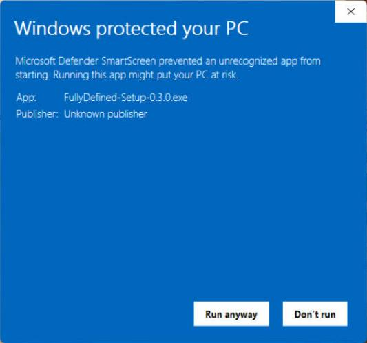

Windows 10 or 11, SOLIDWORKS 2022 or later, and an AI app. No administrator rights needed.

## 1. Download

**[Download for Windows](https://github.com/adinomyerson/FullyDefined-AI-for-SOLIDWORKS/releases/latest)**: the file
`FullyDefined-Setup-<version>.exe`.

## 2. Run it

Double-click it. Windows warns because the installer is not code-signed: click **More info**, then **Run anyway**.

## 3. Tick your AI apps and install

The apps found on your PC are already ticked. Keep "Start SOLIDWORKS for this check" ticked: the installer builds a
small test part and tells you it works.

## 4. How to start

Open SOLIDWORKS, fully quit and reopen your AI app, then ask it to build something:

> Create a new part and extrude a 40 mm diameter disc 10 mm thick.

More to try: [Examples](examples.html).

## Requirements

- Windows 10 or 11.
- SOLIDWORKS 2022 or later, installed and licensed. Tested on SOLIDWORKS 2026 SP4.1, set to English, on Windows 11;
  parts and assemblies from templates in other languages work too.
- An AI app that runs local MCP servers. ChatGPT cannot use it: it connects only to remote servers, and this server
  must run on the SOLIDWORKS computer.

## Works with

<ul class="apps">
  <li>TestedClaude Desktop and Claude Code, with the Claude Opus and Claude Sonnet models.</li>
  <li>Installed and usedAntigravity.</li>
  <li>Should workGemini CLI, VS Code with GitHub Copilot, and other apps that run local MCP servers. Please report how it goes.</li>
  <li>NoteCursor gives the model only about 40 tools, fewer than building a part needs.</li>
</ul>

## Update or uninstall

To update, run the new release's installer (the `.exe`, or the zip's **Install SolidWorks MCP**): your settings and
logs stay. To uninstall: Settings > Apps > Installed apps > **SolidWorks MCP** > Uninstall.

Other setups (the zip, Antigravity, other apps, where files go): [Help](help.html#more-setup).
